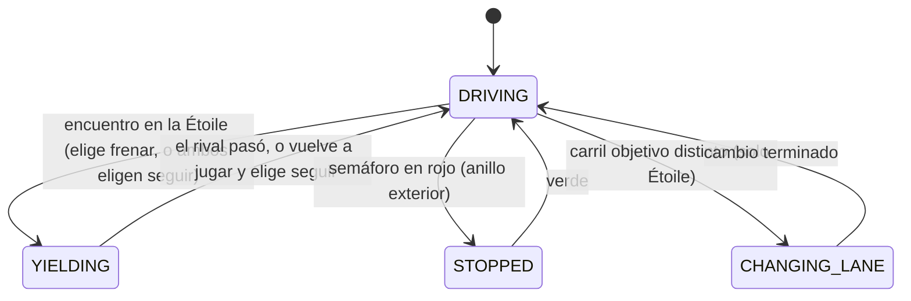
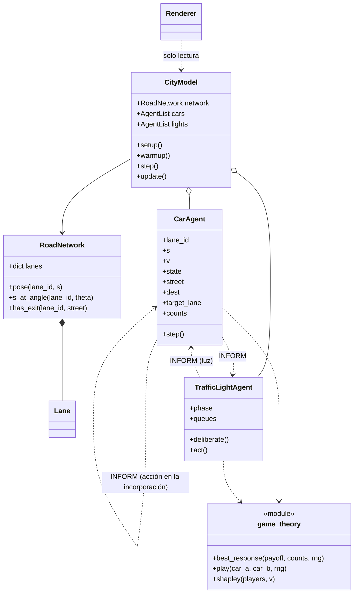

<!-- v0.6.3 | 2026-11-26 | Franco De Escondrillas Vázquez -->
# Plan y reglas del proyecto — Simulación de tráfico en la Étoile

Documento de referencia del equipo: cómo se construye el proyecto, qué reglas se respetan y cómo resuelven los agentes el problema de saber **dónde están y hacia dónde pueden moverse**. Principio rector: **lo más simple que cumpla la rúbrica**. Cualquier cambio a este documento sube la versión de la primera línea.

---

## 1. Resumen y decisiones

**Reto (TC2008B):** simular gráficamente el tráfico como salida de un sistema multiagentes (AgentPy + PyOpenGL), con una ciudad 3D, `n` coches que dan vueltas y cambian de carril, una máquina de estados y semáforos visibles (ver `docs/Activity.md` y `docs/Proposal.md`).

| Tema | Decisión |
| --- | --- |
| Mapa | Étoile (5 carriles) + anillo exterior Tilsitt/Presbourg (1 carril) + 12 avenidas entre ambos. Ambas glorietas giran en sentido antihorario. **Sistema cerrado:** los coches nunca salen. |
| Carriles de avenida | Por ahora solo se simula **un carril por sentido** (el carril 0). Los demás carriles se ven en el mapa, pero no se usan. |
| Cambios de carril | Solo dentro de la Étoile. El carril depende de cuántas calles avanza el coche (sección 5.5). |
| Semáforos | Uno en cada punto donde una avenida saliente se incorpora al anillo exterior: 11 semáforos. Av. Mac-Mahon solo entra y en su cruce no se incorpora nadie. La Étoile no tiene semáforos (igual que en la realidad). |
| Velocidad máxima | 50 km/h en todo el mapa (`MAX_SPEED = 50 / 3.6` m/s en `config.py`). |
| Destino | Las 12 avenidas son calles numeradas del 1 al 12. Al llegar a una, el coche sortea la siguiente con `randint(1, 12)` (sección 5.4). |
| Coches persistentes | Los mismos `n` coches van de calle en calle durante toda la simulación y conservan lo aprendido. Solo la inicialización les da posiciones concretas. |
| Estrategia en la Étoile | Un solo juego de **dos roles** (el que se integra y el que circula) con matriz de pagos fija. Los coches son egoístas, aprenden con **juego ficticio** y solo de sus propios encuentros. Antes de salir toman un *curso de manejo*: rondas en parejas, sin gráficos (propuesta 1, sección 6.2). |
| Estrategia en el anillo exterior | Semáforos BDI que reparten el verde con el valor de Shapley (propuesta 2, basada en `docs/Ejemplo_coaliciones.pdf`). |
| Integración | Un solo proceso: el ciclo de pygame llama a `model.sim_step()` y el renderizador solo lee el estado. `train.ipynb` corre antes el curso de manejo y guarda a los conductores en `drivers.json`, que carga `main.py`. |

---

## 2. Equipo

| Nombre | Matrícula | Rol principal (propuesto) |
| --- | --- | --- |
| Franco De Escondrillas Vázquez | A01739410 | Red vial y agentes |
| Enrique Jiménez Cruz | A01739769 | Gráficas, integración y métricas |

> El nombre en la línea de versión de cada documento (`<!-- vX.X.X | fecha | Nombre -->`) debe coincidir exactamente con esta tabla.

---

## 3. Reglas

1. **Idioma:**
   - código, nombres de archivos y carpetas, y mensajes de commit en **inglés**;
   - comentarios, docstrings, documentación y texto en pantalla en **español**.
2. **Encabezados:**
   - código escrito con Claude Code: primera línea `#  Franco De Escondrillas ft. Claude Code · YYYY-MM-DD`;
   - código escrito solo por una persona: `#  Nombre · YYYY-MM-DD`;
   - documentos: `<!-- vX.X.X | fecha | Nombre -->`;
   - commits y PRs sin atribución a Claude.
3. **Estilo:**
   - PEP 8 y anotaciones de tipo en funciones públicas;
   - `@dataclass` para datos;
   - comentarios solo donde explican el *por qué*;
   - **todas las constantes en `config.py`**, sin números mágicos.
4. **Unidades y marco:**
   - **Unidades:** SI, con radianes dentro del modelo y grados solo al llamar a OpenGL.
   - **Marco único:** el del mapa: metros, Y hacia arriba, +X = este, −Z = norte. El modelo trabaja en el plano `(x, z)`.
   - **Ángulo polar:** `θ = atan2(−z, x)`, antihorario visto desde arriba. Al circular por una glorieta, `θ` crece.
   - **Rumbo:** `ψ = atan2(−dz, dx)`, que se dibuja con `glRotatef(degrees(ψ), 0, 1, 0)` en un modelo que mira hacia +X.
5. **Capas:**
   - solo `renderer.py` y `main.py` importan `pygame` u `OpenGL`, de modo que todo lo demás corre sin ventana (entrenamiento y experimentos);
   - el renderizador nunca modifica el estado.
6. **Reproducibilidad:** semilla fija y paso de simulación fijo (`SIM_DT`).
7. **Licencias:** el mapa es CC BY-NC-SA y los datos de calles ODbL. Se conserva `ATTRIBUTION.txt` y el uso es no comercial.
8. **Git:**
   - trabajo en ramas y PR revisado por el otro integrante;
   - `main` siempre corre;
   - `.gitignore` incluye `.DS_Store`, `__pycache__/` y `.venv/`.

**Antes de cada merge:**

- [ ] `python -m environment.road_network` pasa sus comprobaciones.
- [ ] `python -m environment.city_model` corre 10 min simulados sin traslapes ni atasco total.
- [ ] `notebooks/train.ipynb` y `notebooks/coalitions.ipynb` corren y pasan sus comprobaciones.
- [ ] `main.py` corre sin errores.
- [ ] Se respetan el idioma y los encabezados.
- [ ] La documentación está al día.

---

## 4. Estructura del repositorio

Carpetas planas y pocos archivos. Cada archivo corresponde a una idea que se puede explicar en la presentación.

```
traffic-simulation/
├── Plan&rules.md
├── README.md               # requisitos (agentpy, numpy, pygame, PyOpenGL, matplotlib) y estructura
├── main.py                 # ventana pygame + simulación en vivo
├── config.py               # todas las constantes (rutas absolutas desde la raíz)
├── drivers.json            # conductores con curso de manejo (lo escribe train.ipynb)
├── agents/                 # quienes deciden (sin ventana)
│   ├── car_agent.py        # CarAgent: máquina de estados, IDM, cambios de carril
│   ├── traffic_light.py    # TrafficLightAgent (BDI)
│   └── game_theory.py      # juego ficticio y valor de Shapley (funciones puras)
├── environment/            # el mundo en que actúan (sin ventana)
│   ├── road_network.py     # Lane + RoadNetwork: arma la red y responde dónde está cada coche
│   └── city_model.py       # CityModel(ap.Model) + métricas: une red y agentes
├── visual/                 # lo único que importa OpenGL
│   ├── renderer.py         # cámara, mapa, coches y semáforos
│   └── objloader.py        # copiado del ejemplo de clase
├── notebooks/              # sin ventana; su primera celda agrega la raíz a sys.path
│   ├── train.ipynb         # curso de manejo, su gráfica y drivers.json
│   └── coalitions.ipynb    # comprobaciones y tabla del reparto del verde con Shapley
├── assets/                 # mapa (arc_de_triomphe/) y coche en piezas (car/)
├── docs/                   # Activity.md, Proposal.md, PDF, reportes
└── reference/              # ejemplos de clase, sin modificar
```

**Cómo se ensamblan las piezas** (mismo esqueleto que `reference/Ejemplo_carro/main.py`):

```python
model = CityModel({"n_cars": N_CARS, "seed": SEED, "drivers": DRIVERS_FILE})   # sin archivo: novatos
model.sim_setup()
renderer = CityRenderer()                 # carga el mapa, los semáforos y el coche una sola vez
while not done:
    acc += frame_time * speed
    while acc >= SIM_DT:                  # simulación a paso fijo, independiente de los FPS
        model.sim_step()
        acc -= SIM_DT
    renderer.draw(model)                  # solo lectura
```

- El OBJ del mapa ya está en Y-arriba, así que se carga con `swapyz=False`. Los modelos de coche de clase usan `swapyz=True`.
- Los coches se escalan a un largo real de ≈ 4.5 m.
- La carrocería, el giro de las llantas y la dirección se dibujan igual que en `Carro.py`.
- El coche y los semáforos se dibujan desde VBOs: con display lists por cara, 60 coches no llegan a 30 FPS.

---

## 5. Localización y movimiento

### 5.1 La red: dos anillos y doce radios

El análisis de `road_graph.json` muestra que el área elegida tiene una forma muy simple:

```
          anillo exterior (1 carril, antihorario, R ≈ 167 m)
                 ▲ │                      ▲ │
     radio saliente │ radio entrante  ...  (12 avenidas)
                 │ ▼                      │ ▼
          Étoile (5 carriles, antihorario, R ≈ 63–74 m)
```

- **Radios:** 11 radios entrantes (anillo → Étoile) y 11 salientes (Étoile → anillo). Av. Mac-Mahon solo entra y Av. Marceau solo sale.
- **No hay cruces, solo uniones y separaciones.** Como el anillo exterior es de un solo sentido y las avenidas terminan en él:
  - en la Étoile, entrar es incorporarse al carril 0 (giro a la derecha) y salir es separarse del carril 0 (giro a la derecha);
  - en el anillo exterior, el radio saliente se incorpora al anillo y el anillo se separa hacia el radio entrante. Ambos son giros a la izquierda, pero **sin tráfico en sentido contrario**.

  El único conflicto posible es la **incorporación**. Esto elimina las zonas de conflicto genéricas, los cruces con varias fases y las vueltas a la izquierda con tráfico opuesto.
- **Lo que falta en el JSON y se genera:** las avenidas terminan de 3 a 15 m antes de cada glorieta y no hay conexiones. Al construir la red se **alarga cada radio con una curva** (Hermite cúbica: posición y tangente continuas) desde su punto final hasta el carril de la glorieta. La curva pasa a formar parte de la polilínea del mismo radio, de modo que no existen objetos "conector" aparte.
- **Detalles de los datos:**
  - Los 10 tramos OSM de la Étoile se encadenan en 5 carriles cerrados. Sus radios no son de un círculo perfecto: ≈ 74 / 71 / 68 / 66 / 63 m del carril 0 (exterior) al 4.
  - El anillo exterior no se toma de OSM: sus tramos se desvían hasta 3 m de la calle dibujada. Es 1 carril cerrado en un círculo ajustado a esa calle (centro (−3.25, 1.6) m, R = 166.9 m, a ≤ 1.1 m del centro de la calle). No está centrado en el Arco: un círculo centrado en el origen se saldría hasta 4.6 m.
  - Las curvas hacia y desde la Étoile son más cerradas que las del anillo exterior (recorte de 5 m y unión a 6 m sobre el carril 0, contra 6 m y 12 m), para que el coche no se abra fuera de la calle al girar.
  - Se descartan los carriles de servicio.

### 5.2 Un solo archivo: `environment/road_network.py`

```python
@dataclass
class Lane:
    id: str                 # "etoile_0".."etoile_4", "ring", "foch_in", "foch_out", ...
    points: np.ndarray      # (N, 2) en (x, z), remuestreado cada 0.5 m
    s: np.ndarray           # longitud de arco acumulada en cada punto
    loop: bool              # True en las glorietas: s da la vuelta
    street: int | None = None     # radios: número de calle, 1..12
    exits: dict[int, tuple[float, str]] = field(default_factory=dict)  # calle -> (s donde sale su radio, id del radio)
    end_lane: str | None = None   # radios: glorieta a la que se incorporan
    end_s: float = 0.0            # radios: s de incorporación en esa glorieta
    left: str | None = None       # Étoile: carril de la izquierda (hacia dentro)
    right: str | None = None

class RoadNetwork:
    def __init__(self, path): ...          # lee road_graph.json y arma todo (es rápido, sin caché)
    def pose(self, lane_id, s): ...        # -> (x, z, ψ, κ)
    def s_at_angle(self, lane_id, θ): ...  # glorietas: s en el ángulo polar θ (para cambiar de carril)
    def has_exit(self, lane_id, street): ...  # ¿esa calle tiene salida desde esta glorieta?
    def plot(self): ...                    # vista superior para depurar

if __name__ == "__main__":                 # autoprueba: comprobaciones de la sección 5.6 + plot()
```

Con unas 30 polilíneas en total, todo cabe en un archivo de unas 200 líneas.

### 5.3 ¿Dónde estoy?

Cada coche **lleva** su posición: `(lane_id, s, v)`, donde `s` son los metros recorridos sobre su carril. Nunca busca en el mapa.

- **Avance:** `s += v·dt`.
  - En una glorieta, si `s ≥ length` se hace `s -= length`.
  - En un radio, al llegar al final se pasa a `end_lane` con `s = end_s`.
- **Pose para dibujar:** interpolación lineal entre los dos puntos de la polilínea más cercanos a `s`. El rumbo `ψ` sale de la tangente de ese tramo.

### 5.4 ¿Hacia dónde puedo ir?

- **En un radio:** solo hacia adelante.
- **En una glorieta:**
  - seguir en el mismo carril;
  - al pasar por la salida de su calle destino (en la Étoile, solo desde el carril 0), tomar ese radio;
  - en la Étoile, cambiar a `left` o `right`.
- **Calles:** las 12 avenidas se numeran del 1 al 12 en sentido antihorario desde Friedland, el mismo orden de `TRAFFIC_LIGHTS` (Mac-Mahon = 4, Marceau = 11).
- **Ruta:** cada coche guarda su calle actual (`street`) y su calle destino (`dest`). Al entrar a una calle:
  1. `street = dest`;
  2. sortea `dest = model.random.randint(1, 12)` (el generador del modelo, por la semilla fija);
  3. **repite el tiro** si salió la calle actual o una que no se puede alcanzar desde la glorieta siguiente: Mac-Mahon si va hacia la Étoile (solo entra) o Marceau si va hacia el anillo exterior (solo sale).

  Con eso el coche alterna solo entre glorietas: radio entrante → Étoile → radio saliente de `dest` → anillo exterior → radio entrante del nuevo `dest` → ... No hacen falta Dijkstra ni matrices origen-destino. Un **viaje** es ir de una calle a la siguiente, por cualquiera de las dos glorietas.
- **Desvío por la Étoile (`ETOILE_DETOUR = 5`):** si un coche sale al anillo exterior y su destino queda a más de 5 calles en sentido antihorario, avanza por el anillo a la siguiente calle que entra (1, o 2 si la siguiente es Marceau), cruza la Étoile y sale por el radio de su destino. A Mac-Mahon se llega siempre por el anillo, porque no tiene salida desde la Étoile. En el barrido (20 min, 5 semillas) con 100 coches sube de ≈ 48 a ≈ 58 destinos por minuto y baja el viaje promedio de ≈ 125 s a ≈ 102 s. Con 150 coches se atasca 1 de cada 5 corridas, y con 200, 4 de 5. Por eso **se prueba siempre con N ≤ 100** (`N_CARS = 100`).
- **Inicialización:** es lo único con posiciones concretas. Los `n` coches se reparten en los 22 radios con separación mínima (150 coches son ≈ 7 por radio de ≈ 95 m) y ahí tiran su primer destino. Nadie empieza dentro de una glorieta.

### 5.5 Glorietas: ¿cuánto hay que girar?

El coche **no calcula giros**: sigue la tangente de su carril, por lo que se mantiene en él aunque la glorieta no sea un círculo perfecto. El giro sí se expresa explícitamente para las gráficas y la validación:

- **Giro por paso:** `Δψ = v·κ·dt ≈ v·dt / R`. Por ejemplo, en el carril 0 a 50 km/h con `dt = 0.1 s` son ≈ 1.08° por paso (≈ 0.48° en el anillo exterior).
- **Ángulo de las llantas delanteras:** `δ = atan(L·κ)`, con `L` la distancia entre ejes (igual que en `Carro.py`).
- **Giro total de un viaje por la Étoile:** `Δψ = Δθ − 180°` (−90° al entrar + el ángulo recorrido `Δθ` + −90° al salir).
  - Cruzar de frente (`Δθ = 180°`) da 0°.
  - Tres cuartos de vuelta (`Δθ = 270°`) da +90°, un giro a la izquierda.

**Carril objetivo en la Étoile:** depende solo de cuántas calles avanza el coche, `(dest − street) mod 12`, de 1 a 11 (Mac-Mahon también cuenta):

| Calles que avanza | 1–2 | 3–5 | 6–8 | 9–11 |
| --- | --- | --- | --- | --- |
| Carril | 1.º (`etoile_0`, exterior) | 2.º (`etoile_1`) | 3.º (`etoile_2`) | 4.º (`etoile_3`) |

Los cortes son `LANE_BY_STREETS = (3, 6, 9)`. El quinto carril (`etoile_4`) se ve en el mapa, pero no se usa.

- **Reserva por carril:** 1/12 de vuelta (`LANE_CHANGE_ARC = 2π/12`, 30°). Con `k` el índice del carril actual:
  - hacia dentro: solo si `Δθ_restante > (k + 1)·LANE_CHANGE_ARC`, para que alcance a volver;
  - hacia fuera: empieza cuando `Δθ_restante ≤ k·LANE_CHANGE_ARC`.

  La maniobra ocupa ≈ 1/24 de vuelta y el resto es margen para encontrar un hueco. El carril `k` exige al menos `3k` calles, así que, en el caso más corto, queda ≈ un tercio para entrar, un tercio para circular y un tercio para salir.
- Si el coche no llega al carril 0 antes de su salida, da **otra vuelta**.
- **Cambio de carril:**
  - se permite si hay un hueco libre de `GAP_FRONT` adelante y `GAP_BACK` atrás en el carril destino;
  - la nueva `s` sale de `s_at_angle(destino, θ)`;
  - durante `LANE_CHANGE_TIME`, el dibujo mezcla linealmente la pose vieja con la nueva.

**Prueba preliminar de la regla.** Prototipo sin ventana: IDM, ángulos reales de las avenidas, anillo exterior reemplazado por un retraso, sin semáforos y con la glorieta con prioridad; 6 semillas. Los números definitivos salen de M2.

| Regla | Encuentros/min | Pierden su salida | Pasadas por la Étoile/min | Tiempo en carriles 0–4 (%) |
| --- | --- | --- | --- | --- |
| **80 coches** | | | | |
| v0.4.0 (al azar, 72° por carril), reserva 1/12 | 26.3 | 8.5 % | 44.4 | 42 / 31 / 16 / 8 / 2 |
| **3-6-9, reserva 1/12** | **3.2** | 10.0 % | 45.8 | **21 / 29 / 28 / 23 / 0** |
| 3-6-9, reserva 1/24 | 2.0 | 23.2 % | 39.2 | 7 / 19 / 26 / 48 / 0 |
| 3-6-9, reserva 1/8 | 13.5 | 6.6 % | 46.1 | 28 / 32 / 24 / 16 / 0 |
| **150 coches** | | | | |
| v0.4.0 (al azar, 72° por carril), reserva 1/12 | 88.7 | 16.2 % | 68.1 | 36 / 32 / 20 / 9 / 3 |
| **3-6-9, reserva 1/12** | **23.8** | 21.1 % | 74.4 | **17 / 27 / 29 / 26 / 0** |
| 3-6-9, reserva 1/24 | 15.8 | 27.6 % | 57.9 | 7 / 20 / 33 / 39 / 0 |
| 3-6-9, reserva 1/8 | 50.1 | 13.5 % | 78.0 | 26 / 32 / 26 / 15 / 0 |

- La regla baja los encuentros a ≈ 1/8 con 80 coches y a ≈ 1/4 con 150.
- 1/24 no da tiempo de salir y los coches se acumulan adentro. 1/8 pierde menos salidas, pero multiplica los encuentros por 2 a 4. Queda 1/12.
- Otros cortes (2-5-8, 3-7-10, 4-7-10, 2-6-10) y usar el quinto carril dan ±1 pasada/min. 2-5-8 tiene algo menos de encuentros, pero pierde más salidas. Quedan los más simples, 3-6-9.

**Seguir al de adelante:** se usa IDM (Intelligent Driver Model): una fórmula de aceleración que depende de la distancia y de la diferencia de velocidad con el coche de adelante. Cada carril mantiene sus coches ordenados por `s` (con vuelta en las glorietas). Si aun así un hueco baja de `MIN_GAP`, se frena de golpe. Así nunca hay traslapes y no se necesita física de colisiones.

### 5.6 Comprobaciones (`python -m environment.road_network`)

- [ ] 5 carriles cerrados en la Étoile, 1 en el anillo exterior, 11 radios entrantes y 11 salientes.
- [ ] Todo radio empieza en una salida de un anillo y termina incorporándose al otro.
- [ ] Ningún salto entre puntos supera 1 m y no hay quiebres de rumbo mayores a 10° en las uniones.
- [ ] Sumar `κ·Δs` a lo largo de un carril cerrado da ≈ 360°.
- [ ] `plot()` muestra lo que se espera: se revisa a ojo una vez.

---

## 6. Agentes

### 6.1 `CarAgent`: reactivo con máquina de estados



- Cuatro estados son suficientes. `DRIVING` incluye seguir al de adelante (IDM), así que no hace falta un estado aparte.
- La misma máquina controla las gráficas: luces de freno en `YIELDING` y `STOPPED`, intermitente en `CHANGING_LANE`, y las llantas giran según `v`.

### 6.2 Étoile: juego de dos roles con juego ficticio (`game_theory.py` + `car_agent.py`)

En la Étoile no hay semáforos: los coches se coordinan solos. Hay **un solo juego**, siempre entre dos coches y con los mismos dos roles. El carril no se juega: lo fija la sección 5.5.

- **Rol A, el que se integra:** el primer coche de un radio entrante, cerca de su final.
- **Rol B, el que circula:** el coche del carril 0 que llegará al punto de incorporación en menos de `T_CONFLICT` s y que no sale antes (se sabe por su intermitente).

Si no hay rival, A entra sin jugar. Si B ya no puede frenar a tiempo, pasa y tampoco se juega.

**Matriz de pagos** (fija, `PAYOFFS` en `config.py`; pago propio según la acción propia y la del rival). Frenar cuesta 1 a A, que ya viene despacio, y 2 a B, que viene rápido y frena a los de atrás. Si ambos frenan, cada uno pierde 1 más porque hay que volver a jugar. El choque pesa mucho más que todo lo demás.

| | El rival frena (C) | El rival sigue (D) |
| --- | --- | --- |
| **A** frena (C) | −2 | −1 |
| **A** sigue (D) | 0 | −20 |
| **B** frena (C) | −3 | −2 |
| **B** sigue (D) | 0 | −20 |

**Creencias y decisión** (como `FictitiousPlayAgent` de la clase): cada coche guarda `counts[rol][acción del rival]`, 4 números que empiezan en 1.

1. `p = counts[rol] / sum(counts[rol])`.
2. Elige la acción con mayor `PAYOFFS[rol] @ p` (empate al azar).
3. Ve la acción del rival (luces de freno o `INFORM`) y hace `counts[rol][acción] += 1`.

Cada coche aprende **solo de sus propios encuentros**. No hay temperatura, descuento ni creencias compartidas.

**Resultado en la calle:**

- D contra C: pasa quien eligió D y el otro queda en `YIELDING` hasta que pase. Con el siguiente rival empieza otro encuentro.
- C contra C: los dos frenan y vuelven a jugar tras `RETRY_TIME`.
- D contra D: es el *choque* del juego. Se registra tal cual (los dos eligieron D, también en las gráficas). No hay colisión física: los dos frenan de golpe (IDM, `MIN_GAP`) y vuelven a jugar tras `RETRY_TIME`.
- **Regla contra el atasco total:** si el radio saliente de `dest` no tiene espacio al final, A está obligado a ceder, sin jugar.

**Curso de manejo (calentamiento):** con la regla de carriles hay ≈ 3 encuentros por minuto entre 80 coches, muy pocos para que cada uno aprenda por su cuenta. Por eso `train.ipynb` corre antes `CityModel.warmup(WARMUP_ROUNDS = 60)` sin gráficos. En cada ronda se barajan los coches, se forman parejas, se sortean los roles, juegan y actualizan sus conteos (si `n` es impar, uno descansa). Tarda una fracción de segundo. `train.ipynb` grafica la proporción que elige seguir (D) en cada rol y la creencia promedio, y guarda los conteos de cada coche en `drivers.json`. `main.py` los carga (mismo `N_CARS` y semilla); sin el archivo, los conductores son novatos. Después, en la calle, cada coche sigue aprendiendo de sus encuentros.

**Qué se aprende y por qué:**

1. Al inicio la creencia es 50/50 y el choque pesa tanto que **todos frenan** desde la primera ronda.
2. Al ver que los demás frenan, seguir derecho parece cada vez menos riesgoso. B sigue cuando cree que se cruza con menos de 1/7 (3/21), lo que ocurre a las 6 observaciones; A, con menos de 2/21, a las 9.
3. B se adelanta, A observa D y vuelve a frenar. Cada vez más coches siguen como B y frenan como A.
4. Queda una **convención**: pasa la glorieta y cede el que se integra. Es un equilibrio de Nash puro que nadie impuso; la contraria también lo es. Tener roles distintos rompe la simetría (Selten, 1980) y el juego ficticio converge en juegos 2×2 (Miyasawa, 1961). Aquí las parejas cambian cada ronda, así que se comprueba además por simulación.

**Prueba preliminar** (mismo prototipo de la sección 5.5):

- En 1000 calentamientos (20, 50, 80, 100 y 150 coches, 200 semillas cada uno) **todos** los coches terminaron en esa convención tras 60 rondas. La última ronda con algún encuentro sin coordinar fue la 20–29 (mediana, según `n`) y la 52 en el peor caso.
- En promedio hay entre 0.4 y 3.2 choques D/D en *todo* el calentamiento.
- En la calle, con 80 coches, sin calentamiento el 78 % de las jugadas son de ambos frenando (54 % con 150), medido durante 30 min; con calentamiento, 0 %. Los choques D/D son casi nulos en ambos casos (menos de 0.1 por minuto), porque los novatos son demasiado prudentes, no imprudentes. Las pasadas por minuto casi no cambian.

**Funciones puras en `game_theory.py`:** `belief(counts)`, `best_response(payoff, counts, rng)`, `play(counts_a, counts_b, rng)`, `shapley(players, v)`, `coalition_value(queues, S)` y `green_split(queues, default)`. Ahí también vive el mensaje `Inform`, que comparten coches y semáforos. Como comparación opcional para el reporte: `regret_matching(regrets)` (visto en clase).

**¿Por qué juego ficticio?** Es el método de la clase, cabe en pocas líneas, aprende con pocos datos (una creencia por rol) y su proceso se puede explicar y graficar.

**Nota para el reporte:** en la Étoile real tiene prioridad quien entra (*priorité à droite*). Aquí no se impone prioridad, y los pagos hacen surgir la contraria. Cuál convención gane **no cambia el flujo en el modelo completo** (`Agentic.ipynb`, 10 min simulados, 6 semillas, convención forzada en la calle):

| Viajes de calle a calle | 60 coches | 80 | 100 | 120 | 150 |
| --- | --- | --- | --- | --- | --- |
| Pasa la glorieta (B) | 450 | 495 | 499 | 480 | 435 |
| Pasa el que entra (A) | 454 | 505 | 502 | 483 | 436 |

Ninguna de esas 60 corridas se atascó: los semáforos del anillo exterior limitan cuántos coches llegan a la Étoile, y solo hay ≈ 7 a 14 encuentros por corrida. El prototipo, que no tiene semáforos ni anillo exterior y manda más coches a la Étoile, sí es sensible: con "pasa el que entra" el flujo cayó a menos de la mitad (muchas veces a cero) en 3 de 6 corridas con 80 coches y en 5 de 6 con 120 y con 150; con "pasa la glorieta", en ninguna. La ventaja de "pasa la glorieta" se presenta entonces como una hipótesis para una Étoile más cargada, no como un resultado de esta simulación.

### 6.3 `TrafficLightAgent`: BDI, uno por incorporación al anillo exterior (11)

- **Fases:** `RING` (pasa el anillo) y `MERGE` (se incorpora el radio saliente).
- **Ciclo (como en el PDF):**
  - *creencias:* colas por fase, a partir de los mensajes `INFORM` de los coches que entran a la zona de aproximación;
  - *deliberación:* qué fase merece el verde;
  - *plan:* pasar por amarillo y luego cambiar.
- **Reparto del verde con Shapley:**
  - **Jugadores:** las dos fases.
  - **Valor de una coalición:** `v(S)` = tiempo ahorrado al dejar pasar las colas de `S` como convoy, con `τ(n) = d + n·h`.
  - **Fórmula:** con dos jugadores, Shapley es `φ_i = ½·v({i}) + ½·(v(T) − v({j}))`.
  - **Implementación:** `game_theory.shapley()` es genérica (fuerza bruta, n ≤ 4), para poder probar después la coordinación entre semáforos vecinos.
- **Extensión del verde:** se extiende hasta `MAX_EXTENSION` mientras siga llegando un convoy. No se implementa la negociación de *platoons* entre coches del PDF, porque el semáforo ya ve la cola.
- **Comunicación:** los coches mandan `INFORM` (llegada y posición) y el semáforo responde con `INFORM` (estado de la luz). Basta para describir los mecanismos de comunicación en el reporte.
- **Se calcula en vivo:** con dos fases, φ solo depende de las colas del momento y cuesta microsegundos, así que no se precalcula. `coalitions.ipynb` comprueba Shapley (ejemplo de clase y fórmula cerrada) y tabula el verde de `MERGE` para colas de 0 a 8 coches.
- **Cabezas visibles:** cada agente actualiza las cabezas `ring`, `merge` y `outside` de su cruce (`TRAFFIC_LIGHTS`). La de fuera copia a `MERGE`, porque el sistema es cerrado. Mac-Mahon no tiene agente: su anillo queda siempre en verde y la de fuera en rojo.

### 6.4 Diagrama de clases



---

## 7. Métricas y escenarios

- **Métricas** (`self.record` de AgentPy): tiempo medio de viaje y viajes por minuto (de calle a calle, separados por glorieta), tiempo de espera, conflictos por minuto en la Étoile, cola máxima por semáforo, y además:
  - proporción de encuentros C/C, "pasa A", "pasa B" y D/D, por ronda de calentamiento (curva de aprendizaje) y en la calle;
  - porcentaje de coches que no alcanzan su salida en la Étoile;
  - proporción de coches en cada carril de la Étoile.
- **Escenarios:**
  1. Étoile con "la glorieta tiene prioridad", con "la entrada tiene prioridad", con Nash mixto fijo (A sigue con 1/7 y B con 2/21) y con juego ficticio, con 0 y con 60 rondas de calentamiento (opcional: *regret matching*).
  2. Semáforos de tiempo fijo contra Shapley.
  3. Densidad de 20, 50, 100 y 150 coches.

  Cada escenario se corre con 5 semillas.

---

## 8. Plan de trabajo

| Hito | Contenido | Listo cuando |
| --- | --- | --- |
| **M0** | Reacomodo del repositorio, requisitos en `README.md`, `.gitignore` | `main.py` vacío abre la ventana con el mapa |
| **M1** | `road_network.py` | Pasan las comprobaciones de la sección 5.6 |
| **M2** | `CarAgent` (IDM, salidas, carriles de la Étoile) sin semáforos ni juego | 100 coches durante 10 min simulados sin traslapes ni atascos totales |
| **M3** | `renderer.py` con coches y cámara | Se ve M2 en vivo a ≥ 30 FPS |
| **M4** | `TrafficLightAgent` + Shapley | Semáforos visibles con cambios correctos |
| **M5** | Juego de dos roles en la Étoile + calentamiento + `train.ipynb` (curva) | Al terminar el calentamiento se coordina ≥ 95 % de los encuentros, en la calle hay menos C/C que con `WARMUP_ROUNDS = 0` y el tiempo medio de viaje no es peor que con Nash mixto fijo |
| **M6–M7** | Experimentos, reporte, diagramas, presentación | Entrega |

M3 puede empezar en cuanto exista M1, en paralelo con M2.

---

## 9. Riesgos y preguntas abiertas

**Riesgos:**

- **Atasco total (gridlock):** en un sistema cerrado, si la Étoile se llena nadie puede salir. Hay que limitar el número de coches y añadir una regla: no se entra si no hay espacio al final del radio de salida. Se registra como métrica. En el modelo completo no apareció con ninguna de las dos convenciones, de 60 a 150 coches (sección 6.2). Solo apareció en el prototipo, con más carga en la Étoile y "pasa el que entra", que la matriz asimétrica evita.
- **Anillo exterior saturado:** mide ≈ 1 km de circunferencia y hay 11 semáforos, uno cada ≈ 90 m. Si se forman colas, se bloquean los semáforos vecinos. Por eso `RING` debe ser la fase por defecto y `MERGE` la que pide verde, y el amarillo y los tiempos mínimos se ajustan para que el anillo siga fluyendo.
- **Cuello de botella en el carril 0 de la Étoile:** todas las entradas y salidas usan el carril 0. Es realista. En el prototipo la regla de la sección 5.5 deja ahí ≈ 20 % del tiempo de los coches (antes ≈ 40 %).
- **Salidas perdidas:** en el prototipo ≈ 10 % de las pasadas necesitan otra vuelta (≈ 21 % con 150 coches). Si molesta, se sube `LANE_CHANGE_ARC` a 1/8 de vuelta, a cambio de más encuentros.
- **Poco aprendizaje visible en la calle:** tras el calentamiento la convención ya está formada. La curva se muestra en `train.ipynb`, y con `WARMUP_ROUNDS = 0` se ve a los novatos en vivo.
- **La convención depende de los pagos:** con costos de frenar iguales puede ganar cualquiera de las dos. Si se cambia `PAYOFFS`, se vuelve a comprobar el calentamiento.
- **Lo que se dejó fuera a propósito** (se agrega solo si sobra tiempo):
  - varios carriles por avenida;
  - convoyes negociados entre coches;
  - un modelo de cambio de carril más elaborado (MOBIL);
  - coordinación entre semáforos (onda verde).

**Preguntas abiertas:** ninguna por ahora. Las de la v0.2 quedaron resueltas en la tabla de la sección 1 (velocidad, destino y semáforos).
