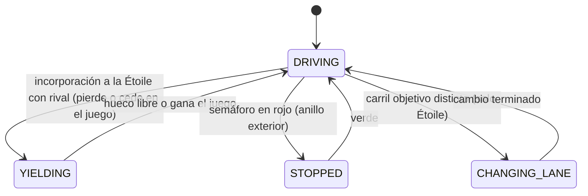
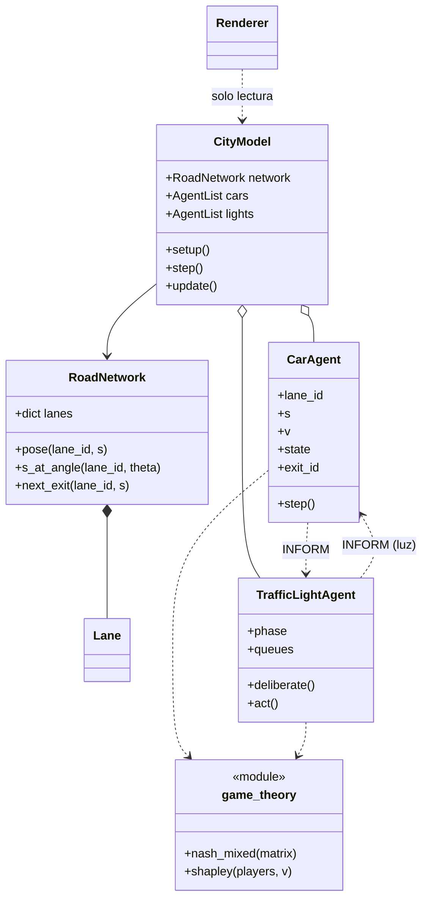

<!-- v0.3.2 | 2026-11-17 | Franco De Escondrillas Vázquez -->
# Plan y reglas del proyecto — Simulación de tráfico en la Étoile

Documento de referencia del equipo: cómo se construye el proyecto, qué reglas se respetan y cómo resuelven los agentes el problema de saber **dónde están y hacia dónde pueden moverse**. Principio rector: **lo más simple que cumpla la rúbrica**. Cualquier cambio a este documento sube la versión de la primera línea.

---

## 1. Resumen y decisiones

**Reto (TC2008B):** simular gráficamente el tráfico como salida de un sistema multiagentes (AgentPy + PyOpenGL), con una ciudad 3D, `n` coches que dan vueltas y cambian de carril, una máquina de estados y semáforos visibles (ver `docs/Activity.md` y `docs/Proposal.md`).

| Tema | Decisión |
| --- | --- |
| Mapa | Étoile (5 carriles) + anillo exterior Tilsitt/Presbourg (1 carril) + 12 avenidas entre ambos. Ambas glorietas giran en sentido antihorario. **Sistema cerrado:** los coches nunca salen. |
| Carriles de avenida | Por ahora solo se simula **un carril por sentido** (el carril 0). Los demás carriles se ven en el mapa, pero no se usan. |
| Cambios de carril | Solo dentro de la Étoile. |
| Semáforos | Uno en cada punto donde una avenida saliente se incorpora al anillo exterior: 11 semáforos. Av. Mac-Mahon solo entra y en su cruce no se incorpora nadie. La Étoile no tiene semáforos (igual que en la realidad). |
| Velocidad máxima | 50 km/h en todo el mapa (`MAX_SPEED = 50 / 3.6` m/s en `config.py`). |
| Elección de salida | Uniforme entre las salidas disponibles. |
| Estrategia en la Étoile | Coches egoístas que juegan el *juego de la gallina* (Nash mixto). Los pagos se ajustan con aprendizaje por refuerzo (propuesta 1). |
| Estrategia en el anillo exterior | Semáforos BDI que reparten el verde con el valor de Shapley (propuesta 2, basada en `docs/Ejemplo_coaliciones.pdf`). |
| Integración | Un solo proceso: el ciclo de pygame llama a `model.sim_step()` y el renderizador solo lee el estado. |

---

## 2. Equipo

| Nombre | Matrícula | Rol principal (propuesto) |
| --- | --- | --- |
| Franco De Escondrillas Vázquez | A01739410 | Red vial y agentes |
| Enrique Jiménez Cruz | A01739769 | Gráficas, integración y métricas |

> El nombre en la línea de versión de cada documento (`<!-- vX.X.X | fecha | Nombre -->`) debe coincidir exactamente con esta tabla.

---

## 3. Reglas

1. **Idioma:**
   - código, nombres de archivos y carpetas, y mensajes de commit en **inglés**;
   - comentarios, docstrings, documentación y texto en pantalla en **español**.
2. **Encabezados:**
   - código escrito con Claude Code: primera línea `#  Franco De Escondrillas ft. Claude Code · YYYY-MM-DD`;
   - código escrito solo por una persona: `#  Nombre · YYYY-MM-DD`;
   - documentos: `<!-- vX.X.X | fecha | Nombre -->`;
   - commits y PRs sin atribución a Claude.
3. **Estilo:**
   - PEP 8 y anotaciones de tipo en funciones públicas;
   - `@dataclass` para datos;
   - comentarios solo donde explican el *por qué*;
   - **todas las constantes en `config.py`**, sin números mágicos.
4. **Unidades y marco:**
   - **Unidades:** SI, con radianes dentro del modelo y grados solo al llamar a OpenGL.
   - **Marco único:** el del mapa: metros, Y hacia arriba, +X = este, −Z = norte. El modelo trabaja en el plano `(x, z)`.
   - **Ángulo polar:** `θ = atan2(−z, x)`, antihorario visto desde arriba. Al circular por una glorieta, `θ` crece.
   - **Rumbo:** `ψ = atan2(−dz, dx)`, que se dibuja con `glRotatef(degrees(ψ), 0, 1, 0)` en un modelo que mira hacia +X.
5. **Capas:**
   - solo `renderer.py` y `main.py` importan `pygame` u `OpenGL`, de modo que todo lo demás corre sin ventana (entrenamiento y experimentos);
   - el renderizador nunca modifica el estado.
6. **Reproducibilidad:** semilla fija y paso de simulación fijo (`SIM_DT`).
7. **Licencias:** el mapa es CC BY-NC-SA y los datos de calles ODbL. Se conserva `ATTRIBUTION.txt` y el uso es no comercial.
8. **Git:**
   - trabajo en ramas y PR revisado por el otro integrante;
   - `main` siempre corre;
   - `.gitignore` incluye `.DS_Store`, `__pycache__/` y `.venv/`.

**Antes de cada merge:**

- [ ] `python sim/road_network.py` pasa sus comprobaciones.
- [ ] `main.py` corre sin errores.
- [ ] Se respetan el idioma y los encabezados.
- [ ] La documentación está al día.

---

## 4. Estructura del repositorio

Carpetas planas y pocos archivos. Cada archivo corresponde a una idea que se puede explicar en la presentación.

```
traffic-simulation/
├── Plan&rules.md
├── README.md               # requisitos (agentpy, numpy, pygame, PyOpenGL, matplotlib) y estructura
├── main.py                 # ventana pygame + simulación en vivo
├── train.py                # sin ventana: ajuste de pagos y experimentos
├── sim/
│   ├── config.py           # todas las constantes
│   ├── road_network.py     # Lane + RoadNetwork: arma la red y responde dónde está cada coche
│   ├── game_theory.py      # Nash mixto 2x2 y valor de Shapley (funciones puras)
│   ├── car_agent.py        # CarAgent: máquina de estados, IDM, cambios de carril
│   ├── traffic_light.py    # TrafficLightAgent (BDI)
│   ├── city_model.py       # CityModel(ap.Model) + métricas
│   ├── renderer.py         # cámara, mapa, coches y semáforos
│   └── objloader.py        # copiado del ejemplo de clase
├── assets/                 # mapa (arc_de_triomphe/) y coche en piezas (car/)
├── docs/                   # Activity.md, Proposal.md, PDF, reportes
└── reference/              # ejemplos de clase, sin modificar
```

**Cómo se ensamblan las piezas** (mismo esqueleto que `reference/Ejemplo_carro/main.py`):

```python
network = RoadNetwork("assets/arc_de_triomphe/road_graph.json")
model = CityModel({"network": network, "cars": 80, "seed": 1})
model.sim_setup()
renderer = Renderer(network)              # carga el mapa (display list) y los coches una sola vez
while not done:
    acc += frame_time * speed
    while acc >= SIM_DT:                  # simulación a paso fijo, independiente de los FPS
        model.sim_step()
        acc -= SIM_DT
    renderer.draw(model)                  # solo lectura
```

- El OBJ del mapa ya está en Y-arriba, así que se carga con `swapyz=False`. Los modelos de coche de clase usan `swapyz=True`.
- Los coches se escalan a un largo real de ≈ 4.5 m.
- La carrocería, el giro de las llantas y la dirección se dibujan igual que en `Carro.py`.

---

## 5. Localización y movimiento

### 5.1 La red: dos anillos y doce radios

El análisis de `road_graph.json` muestra que el área elegida tiene una forma muy simple:

```
          anillo exterior (1 carril, antihorario, R ≈ 165 m)
                 ▲ │                      ▲ │
     radio saliente │ radio entrante  ...  (12 avenidas)
                 │ ▼                      │ ▼
          Étoile (5 carriles, antihorario, R ≈ 63–74 m)
```

- **Radios:** 11 radios entrantes (anillo → Étoile) y 11 salientes (Étoile → anillo). Av. Mac-Mahon solo entra y Av. Marceau solo sale.
- **No hay cruces, solo uniones y separaciones.** Como el anillo exterior es de un solo sentido y las avenidas terminan en él:
  - en la Étoile, entrar es incorporarse al carril 0 (giro a la derecha) y salir es separarse del carril 0 (giro a la derecha);
  - en el anillo exterior, el radio saliente se incorpora al anillo y el anillo se separa hacia el radio entrante. Ambos son giros a la izquierda, pero **sin tráfico en sentido contrario**.

  El único conflicto posible es la **incorporación**. Esto elimina las zonas de conflicto genéricas, los cruces con varias fases y las vueltas a la izquierda con tráfico opuesto.
- **Lo que falta en el JSON y se genera:** las avenidas terminan de 3 a 15 m antes de cada glorieta y no hay conexiones. Al construir la red se **alarga cada radio con una curva** (Hermite cúbica: posición y tangente continuas) desde su punto final hasta el carril de la glorieta. La curva pasa a formar parte de la polilínea del mismo radio, de modo que no existen objetos "conector" aparte.
- **Detalles de los datos:**
  - Los 10 tramos OSM de la Étoile se encadenan en 5 carriles cerrados. Sus radios no son de un círculo perfecto: ≈ 74 / 71 / 68 / 66 / 63 m del carril 0 (exterior) al 4.
  - El anillo exterior se encadena en 1 carril cerrado. Hay que rellenar huecos de hasta 7.5° y descartar un fragmento suelto de Av. Kléber.
  - Se descartan los carriles de servicio.

### 5.2 Un solo archivo: `sim/road_network.py`

```python
@dataclass
class Lane:
    id: str                 # "etoile_0".."etoile_4", "ring", "foch_in", "foch_out", ...
    points: np.ndarray      # (N, 2) en (x, z), remuestreado cada 0.5 m
    s: np.ndarray           # longitud de arco acumulada en cada punto
    loop: bool              # True en las glorietas: s da la vuelta
    exits: list[tuple[float, str]] = field(default_factory=list)  # (s donde sale un radio, id del radio)
    end_lane: str | None = None   # radios: glorieta a la que se incorporan
    end_s: float = 0.0            # radios: s de incorporación en esa glorieta
    left: str | None = None       # Étoile: carril de la izquierda (hacia dentro)
    right: str | None = None

class RoadNetwork:
    def __init__(self, path): ...          # lee road_graph.json y arma todo (es rápido, sin caché)
    def pose(self, lane_id, s): ...        # -> (x, z, ψ, κ)
    def s_at_angle(self, lane_id, θ): ...  # glorietas: s en el ángulo polar θ (para cambiar de carril)
    def next_exit(self, lane_id, s): ...   # siguiente salida hacia adelante
    def plot(self): ...                    # vista superior para depurar

if __name__ == "__main__":                 # autoprueba: comprobaciones de la sección 5.6 + plot()
```

Con unas 30 polilíneas en total, todo cabe en un archivo de unas 200 líneas.

### 5.3 ¿Dónde estoy?

Cada coche **lleva** su posición: `(lane_id, s, v)`, donde `s` son los metros recorridos sobre su carril. Nunca busca en el mapa.

- **Avance:** `s += v·dt`.
  - En una glorieta, si `s ≥ length` se hace `s -= length`.
  - En un radio, al llegar al final se pasa a `end_lane` con `s = end_s`.
- **Pose para dibujar:** interpolación lineal entre los dos puntos de la polilínea más cercanos a `s`. El rumbo `ψ` sale de la tangente de ese tramo.

### 5.4 ¿Hacia dónde puedo ir?

- **En un radio:** solo hacia adelante.
- **En una glorieta:**
  - seguir en el mismo carril;
  - al pasar por la `s` de una salida que el coche eligió (solo desde el carril 0 de la Étoile), tomar ese radio;
  - en la Étoile, cambiar a `left` o `right`.
- **Ruta:** al entrar a una glorieta, el coche sortea de forma **uniforme** cuál salida tomará (en la Étoile, una distinta a la de su entrada). Como la red son dos anillos unidos por radios, eso basta: no hacen falta Dijkstra ni matrices origen-destino. Un viaje completado es una pasada por la Étoile.

### 5.5 Glorietas: ¿cuánto hay que girar?

El coche **no calcula giros**: sigue la tangente de su carril, por lo que se mantiene en él aunque la glorieta no sea un círculo perfecto. El giro sí se expresa explícitamente para las gráficas y la validación:

- **Giro por paso:** `Δψ = v·κ·dt ≈ v·dt / R`. Por ejemplo, en el carril 0 a 50 km/h con `dt = 0.1 s` son ≈ 1.08° por paso (≈ 0.48° en el anillo exterior).
- **Ángulo de las llantas delanteras:** `δ = atan(L·κ)`, con `L` la distancia entre ejes (igual que en `Carro.py`).
- **Giro total de un viaje por la Étoile:** `Δψ = Δθ − 180°` (−90° al entrar + el ángulo recorrido `Δθ` + −90° al salir).
  - Cruzar de frente (`Δθ = 180°`) da 0°.
  - Tres cuartos de vuelta (`Δθ = 270°`) da +90°, un giro a la izquierda.

**Carril objetivo en la Étoile:**

- Se entra por el carril 0 y se busca `target = min(4, ⌊Δθ_restante / 72°⌋)`: los viajes cortos se quedan afuera y los largos se van hacia dentro.
- El coche debe volver al carril 0 antes de su salida. Si no alcanza, da otra vuelta.
- **Cambio de carril:**
  - se permite si hay un hueco libre de `GAP_FRONT` adelante y `GAP_BACK` atrás en el carril destino;
  - la nueva `s` sale de `s_at_angle(destino, θ)`;
  - durante `LANE_CHANGE_TIME`, el dibujo mezcla linealmente la pose vieja con la nueva.

**Seguir al de adelante:** se usa IDM (Intelligent Driver Model): una fórmula de aceleración que depende de la distancia y de la diferencia de velocidad con el coche de adelante. Cada carril mantiene sus coches ordenados por `s` (con vuelta en las glorietas). Si aun así un hueco baja de `MIN_GAP`, se frena de golpe. Así nunca hay traslapes y no se necesita física de colisiones.

### 5.6 Comprobaciones (`python sim/road_network.py`)

- [ ] 5 carriles cerrados en la Étoile, 1 en el anillo exterior, 11 radios entrantes y 11 salientes.
- [ ] Todo radio empieza en una salida de un anillo y termina incorporándose al otro.
- [ ] Ningún salto entre puntos supera 1 m y no hay quiebres de rumbo mayores a 10° en las uniones.
- [ ] Sumar `κ·Δs` a lo largo de un carril cerrado da ≈ 360°.
- [ ] `plot()` muestra lo que se espera: se revisa a ojo una vez.

---

## 6. Agentes

### 6.1 `CarAgent`: reactivo con máquina de estados



- Cuatro estados son suficientes. `DRIVING` incluye seguir al de adelante (IDM), así que no hace falta un estado aparte.
- La misma máquina controla las gráficas: luces de freno en `YIELDING` y `STOPPED`, intermitente en `CHANGING_LANE`, y las llantas giran según `v`.

### 6.2 Juego de incorporación a la Étoile (`game_theory.py` + `car_agent.py`)

- **Cuándo ocurre:** un coche llega al final de su radio y, en el carril 0, hay un coche que llegará al punto de incorporación en menos de `T_CONFLICT` segundos. Si no hay nadie, entra sin jugar.
- **Acciones:** ceder (C) o pasar (D).
- **Pagos:** la matriz del PDF ((1,1), (1,2), (2,1), (0,0)) es la base. La versión ajustable tiene **3 parámetros** `θ`:
  - pago extra al coche que ya circula si pasa;
  - penalización por desertar ambos;
  - peso de la cola que el coche que entra tiene detrás.
- **Decisión:** cada coche juega la estrategia mixta de Nash, `q* = (CD − DD) / (CD − DD + DC − CC)`.
- **Desertar ambos no choca:** los dos frenan de golpe y se registra un *conflicto*.
- **Aprendizaje (`train.py`):** método de entropía cruzada sobre `θ`, una búsqueda de política sin modelo (≈ 30 líneas).
  1. Se sortean N vectores `θ`.
  2. Se corre un episodio sin ventana con cada uno.
  3. Se conservan los mejores según `tiempo_medio_de_viaje + λ·conflictos` y se repite.

  El resultado muestra si el Nash egoísta con los pagos ajustados se acerca al óptimo global. Se compara siempre contra la matriz base.
- **Nota para el reporte:** en la Étoile real tiene prioridad quien entra (*priorité à droite*). Aquí el juego sustituye esa regla.

### 6.3 `TrafficLightAgent`: BDI, uno por incorporación al anillo exterior (11)

- **Fases:** `RING` (pasa el anillo) y `MERGE` (se incorpora el radio saliente).
- **Ciclo (como en el PDF):**
  - *creencias:* colas por fase, a partir de los mensajes `INFORM` de los coches que entran a la zona de aproximación;
  - *deliberación:* qué fase merece el verde;
  - *plan:* pasar por amarillo y luego cambiar.
- **Reparto del verde con Shapley:**
  - **Jugadores:** las dos fases.
  - **Valor de una coalición:** `v(S)` = tiempo ahorrado al dejar pasar las colas de `S` como convoy, con `τ(n) = d + n·h`.
  - **Fórmula:** con dos jugadores, Shapley es `φ_i = ½·v({i}) + ½·(v(T) − v({j}))`.
  - **Implementación:** `game_theory.shapley()` es genérica (fuerza bruta, n ≤ 4), para poder probar después la coordinación entre semáforos vecinos.
- **Extensión del verde:** se extiende hasta `MAX_EXTENSION` mientras siga llegando un convoy. No se implementa la negociación de *platoons* entre coches del PDF, porque el semáforo ya ve la cola.
- **Comunicación:** los coches mandan `INFORM` (llegada y posición) y el semáforo responde con `INFORM` (estado de la luz). Basta para describir los mecanismos de comunicación en el reporte.

### 6.4 Diagrama de clases



---

## 7. Métricas y escenarios

- **Métricas** (`self.record` de AgentPy): tiempo medio de viaje, tiempo de espera, viajes por minuto, conflictos en la Étoile y cola máxima por semáforo.
- **Escenarios:**
  1. Étoile con pagos base contra pagos ajustados.
  2. Semáforos de tiempo fijo contra Shapley.
  3. Densidad de 20, 50, 100 y 150 coches.

  Cada escenario se corre con 5 semillas.

---

## 8. Plan de trabajo

| Hito | Contenido | Listo cuando |
| --- | --- | --- |
| **M0** | Reacomodo del repositorio, requisitos en `README.md`, `.gitignore` | `main.py` vacío abre la ventana con el mapa |
| **M1** | `road_network.py` | Pasan las comprobaciones de la sección 5.6 |
| **M2** | `CarAgent` (IDM, salidas, carriles de la Étoile) sin semáforos ni juego | 100 coches durante 10 min simulados sin traslapes ni atascos totales |
| **M3** | `renderer.py` con coches y cámara | Se ve M2 en vivo a ≥ 30 FPS |
| **M4** | `TrafficLightAgent` + Shapley | Semáforos visibles con cambios correctos |
| **M5** | Juego de la Étoile + `train.py` | Pagos ajustados mejores que los base |
| **M6–M7** | Experimentos, reporte, diagramas, presentación | Entrega |

M3 puede empezar en cuanto exista M1, en paralelo con M2.

---

## 9. Riesgos y preguntas abiertas

**Riesgos:**

- **Atasco total (gridlock):** en un sistema cerrado, si la Étoile se llena nadie puede salir. Hay que limitar el número de coches y añadir una regla: no se entra si no hay espacio al final del radio de salida. Se registra como métrica.
- **Anillo exterior saturado:** mide ≈ 1 km de circunferencia y hay 11 semáforos, uno cada ≈ 90 m. Si se forman colas, se bloquean los semáforos vecinos. Por eso `RING` debe ser la fase por defecto y `MERGE` la que pide verde, y el amarillo y los tiempos mínimos se ajustan para que el anillo siga fluyendo.
- **Cuello de botella en el carril 0 de la Étoile:** todas las entradas y salidas usan el carril 0. Es realista, pero hay que vigilar que la regla de carril objetivo saque a los coches de ahí.
- **Tiempo de entrenamiento:** 100 coches × 3 000 pasos en Python tarda segundos por episodio. Si el método de entropía cruzada tarda demasiado, se reducen los episodios o los coches.
- **Lo que se dejó fuera a propósito** (se agrega solo si sobra tiempo):
  - varios carriles por avenida;
  - convoyes negociados entre coches;
  - un modelo de cambio de carril más elaborado (MOBIL);
  - coordinación entre semáforos (onda verde).

**Preguntas abiertas:** ninguna por ahora. Las de la v0.2 quedaron resueltas en la tabla de la sección 1 (velocidad, elección de salida y semáforos).
